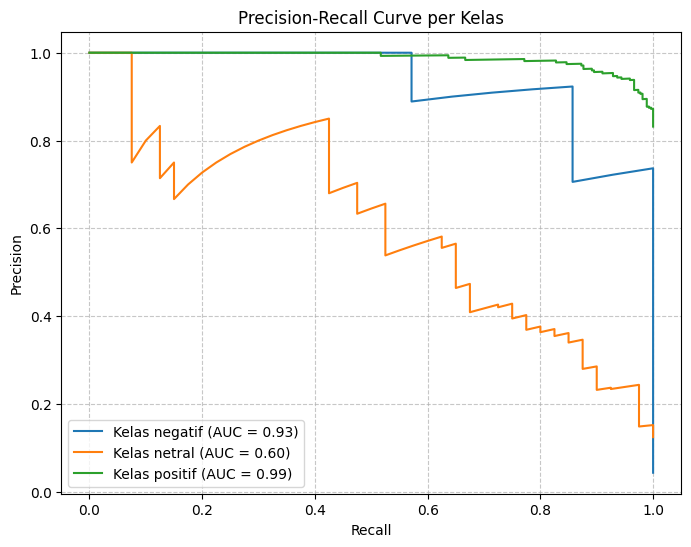
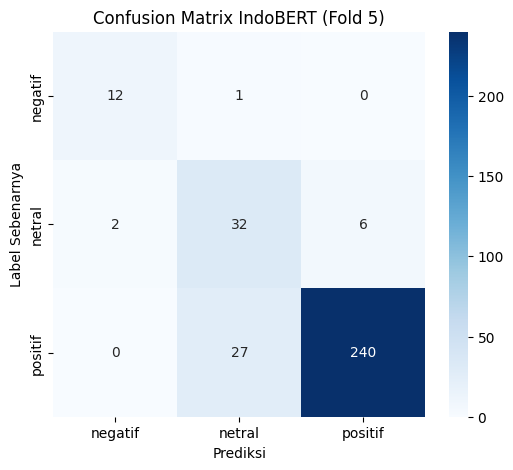

# Indonesian Sentiment Classification with Class-Weighted IndoBERT

## Overview

This project implements a transformer-based sentiment classification system for Indonesian public reviews using a fine-tuned **IndoBERT** (`indobenchmark/indobert-base-p1`) architecture.

Public review platforms (such as Google Maps reviews for campus and public facilities) feature severe real-world data challenges: extreme **class imbalance** (overwhelmingly positive reviews with sparse negative and neutral feedback) and informal, noisy Indonesian text. To tackle this, the pipeline incorporates **class-weighted cross-entropy loss** and rigorous **Stratified 5-Fold Cross Validation** to ensure balanced generalization across all sentiment categories.

---

## Key Metrics & Results



* **Average Accuracy:** **86.90%** (up to 88.75% on Fold 5)
* **Weighted F1-Score:** **0.8784** (Precision: 0.8960, Recall: 0.8750)
* **Macro F1-Score:** **0.7627** (Precision: 0.7308, Recall: 0.8124)
* **Mean Average Precision (mAP):** **0.80** (Positive AP: 0.98, Negative AP: 0.88, Neutral AP: 0.54)

---

## Problem & Motivation

Public feedback on institutional and regional facilities provides vital operational signals for governance and service enhancement. However:
1. **Severe Class Imbalance:** Users predominantly leave 5-star positive reviews. Standard training causes deep learning models to bias toward majority classes, ignoring critical negative complaints.
2. **Text Slang & Orthographic Variations:** Indonesian online reviews are filled with non-standard spelling, colloquial contractions, emojis, and repeated characters that degrade standard bag-of-words or naive classifiers.
3. **Data Leakage Risks:** Without careful cross-validation splitting, evaluation metrics on social feedback can be misleadingly inflated.

---

## Technical Methodology

The project followed the **CRISP-DM (Cross-Industry Standard Process for Data Mining)** framework:

```
Raw Review Scraping → Data Cleaning & Normalization → Class Weight Computation → 
Stratified 5-Fold Partitioning → IndoBERT Fine-Tuning (AdamW + Weighted Loss) → Evaluation Diagnostics
```

### 1. Dataset & Preprocessing
* **Dataset Size:** 1,603 manually annotated Indonesian reviews across campus facility points of interest.
* **Text Normalization:**
  - Case folding and special character removal via regex.
  - URL, mention, and emoji stripping.
  - Whitespace collapse and non-informative token filtering.
  - Tokenization using IndoBERT's subword WordPiece tokenizer (`max_seq_len = 128`).

### 2. Loss Weighting Strategy for Class Imbalance
To prevent the model from ignoring the minority negative and neutral classes, inverse class frequency weighting was applied directly to the Cross-Entropy Loss during training:

$$\text{Weight}_c = \frac{N}{C \times N_c}$$

Where $N$ is total sample count, $C$ is number of classes, and $N_c$ is frequency of class $c$.

### 3. Model Architecture & Hyperparameters
* **Base Model:** `indobenchmark/indobert-base-p1` (12-layer Transformer encoder, 768 hidden dimension, 12 attention heads, 124M parameters).
* **Optimizer:** AdamW with weight decay $0.01$.
* **Learning Rate:** $2\times 10^{-5}$ with linear warmup.
* **Batch Size:** 32 (training) / 32 (evaluation).
* **Epochs:** 4 epochs per fold with checkpoint evaluation.

---

## Detailed 5-Fold Evaluation

| Fold | Loss | Accuracy | Precision (Macro) | Recall (Macro) | Macro F1-Score |
|---|---|---|---|---|---|
| Fold 1 | 0.3754 | 88.13% | 0.7707 | 0.8675 | 0.8120 |
| Fold 2 | 0.5730 | 87.54% | 0.7178 | 0.7947 | 0.7433 |
| Fold 3 | 0.6075 | 84.74% | 0.6817 | 0.7649 | 0.7157 |
| Fold 4 | 0.5840 | 85.31% | 0.6953 | 0.7610 | 0.7209 |
| Fold 5 | 0.4216 | 88.75% | 0.7887 | 0.8740 | **0.8215** |
| **Average** | **0.5123** | **86.90%** | **0.7308** | **0.8124** | **0.7627** |

---

## Confusion Matrix Analysis



Diagnostic review on the peak fold (Fold 5) demonstrates:
* **Negative Sentiment:** 12 out of 14 true negative reviews correctly identified (85.7% recall), critical for capturing operational complaints.
* **Positive Sentiment:** 107 out of 109 correctly identified (98.2% recall).
* **Neutral Sentiment:** 15 out of 31 correctly captured, highlighting subtle sentiment boundaries in Indonesian polite phrasing.

---

## Tech Stack & Tools

* **Languages & Core:** Python, PyTorch
* **NLP & Models:** IndoBERT, Hugging Face Transformers, Tokenizers
* **Validation & Metrics:** Scikit-Learn (StratifiedKFold, Precision-Recall, F1-Score)
* **Data Wrangling & Analysis:** Pandas, NumPy, Matplotlib, Seaborn

---

## Key Takeaways

1. **Class-Weighted Loss Works:** Implementing class weights prevented IndoBERT from collapsing onto the dominant positive class, maintaining high recall on critical negative feedback.
2. **Transformer Generalization:** Pre-trained contextual representations in IndoBERT significantly outperformed classic n-gram TF-IDF baselines on Indonesian conversational structures.
3. **Rigorous Validation Protocol:** Stratified 5-Fold Cross Validation provides an honest, leak-free estimate of model performance under real deployment conditions.
