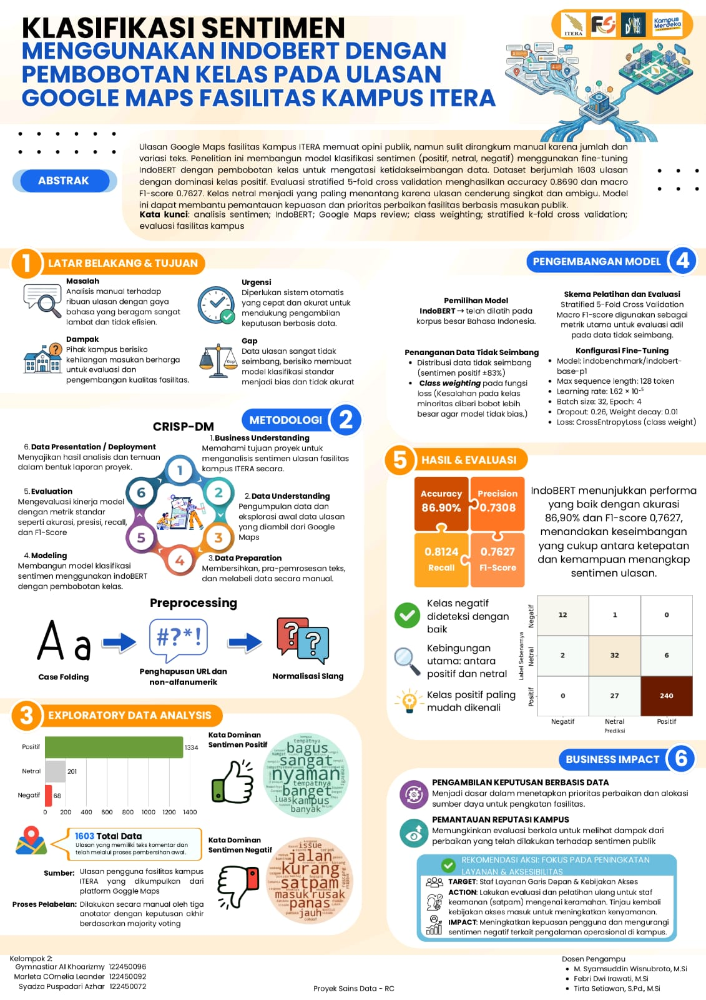

# Indonesian Sentiment Classification with Class-Weighted IndoBERT

## Overview

This project implements an end-to-end transformer-based sentiment classification system for Indonesian public reviews using a fine-tuned **IndoBERT** (`indobenchmark/indobert-base-p1`) architecture.

Public review platforms (such as Google Maps reviews for campus facilities and regional points of interest) present severe real-world data science challenges: extreme **class imbalance** (~83% positive reviews vs. sparse complaints) and noisy, informal Indonesian text filled with colloquial slang. To tackle this, our pipeline incorporates **class-weighted cross-entropy loss** and rigorous **Stratified 5-Fold Cross Validation** to ensure honest generalization across all sentiment categories.

---

## Research Poster



---

## Team & Academic Affiliation

* **Team Members (Kelompok 2):**
  * **Gymnastiar Al Khoarizmy** (122450096)
  * Marleta Cornelia Leander (122450092)
  * Syadza Puspadari Azhar (122450072)
* **Supervising Lecturers (Dosen Pengampu):**
  * M. Syamsuddin Wisnubroto, M.Si
  * Febri Dwi Irawati, M.Si
  * Tirta Setiawan, S.Pd., M.Si
* **Institution:** *Program Studi Sains Data, Institut Teknologi Sumatera (ITERA)*

---

## Key Metrics & Results


* **Average Accuracy:** **86.90%** (up to 88.75% on Fold 5)
* **Macro F1-Score:** **0.7627** (Macro Precision: 0.7308, Macro Recall: 0.8124)
* **Weighted F1-Score:** **0.8784** (Precision: 0.8960, Recall: 0.8750)
* **Mean Average Precision (mAP):** **0.80** (Positive AP: 0.98, Negative AP: 0.88, Neutral AP: 0.54)

---

## Problem & Motivation

Public feedback on Google Maps provides vital operational signals for governance and service enhancement. However:
1. **Severe Class Imbalance:** Users predominantly leave positive 5-star reviews. Standard training causes deep learning models to bias heavily toward majority classes, ignoring critical negative feedback.
2. **Slang & Orthographic Variations:** Indonesian online reviews are filled with non-standard spelling, colloquial contractions, emojis, and repeated characters that degrade standard bag-of-words or naive classifiers.
3. **Data Leakage Risks:** Without careful cross-validation splitting, evaluation metrics on social feedback can be misleadingly inflated.

---

## Technical Methodology (CRISP-DM)

The project followed the **CRISP-DM (Cross-Industry Standard Process for Data Mining)** framework:

```
Business Understanding → Data Understanding (1,603 Scraped Reviews) → Data Preparation & Normalization →
Modeling (IndoBERT + Class Weights) → Evaluation (Stratified 5-Fold) → Presentation & Business Impact
```

### 1. Dataset & Exploratory Data Analysis (EDA)

* **Dataset Size:** 1,603 Indonesian Google Maps reviews across ITERA campus facilities.
* **Class Distribution (Extreme Imbalance):**
  * **Positive:** 1,334 reviews (~83.2%)
  * **Neutral:** 201 reviews (~12.5%)
  * **Negative:** 68 reviews (~4.2%)
* **Annotation Protocol:** Manual labeling by 3 independent annotators with final classification decided via **majority voting**.
* **Key Vocabulary & Semantic Patterns:**
  * **Dominant Positive Terms:** *bagus, sangat, nyaman, banget, luas, kampus, banyak, tempatnya*
  * **Dominant Negative Terms (Operational Issues):** *jalan, kurang, satpam, masuk, rusak, panas, jauh, issue*

### 2. Preprocessing & Normalization Pipeline

```
Raw Text → Case Folding → URL & Non-Alphanumeric Strip → Slang Normalization → WordPiece Subword Tokenizer
```
* **Tokenizer:** IndoBERT subword WordPiece tokenizer (`max_seq_len = 128` tokens).

### 3. Loss Weighting Strategy for Class Imbalance

To prevent the model from ignoring the minority negative and neutral classes, inverse class frequency weighting was applied directly to the Cross-Entropy Loss:

$$\text{Weight}_c = \frac{N}{C \times N_c}$$

Where $N$ is total sample count (1,603), $C$ is number of classes (3), and $N_c$ is frequency of class $c$.

### 4. Fine-Tuning Hyperparameters

* **Base Model:** `indobenchmark/indobert-base-p1` (12-layer Transformer encoder, 768 hidden dimension, 12 attention heads, 124M parameters).
* **Optimizer:** AdamW with weight decay $0.01$.
* **Learning Rate:** $1.62 \times 10^{-5}$ with linear warmup.
* **Dropout:** $0.26$.
* **Batch Size:** 32 (training) / 32 (evaluation).
* **Epochs:** 4 epochs per fold.
* **Validation Scheme:** Stratified 5-Fold Cross Validation.

---

## Detailed 5-Fold Evaluation

| Fold | Loss | Accuracy | Precision (Macro) | Recall (Macro) | Macro F1-Score |
|---|---|---|---|---|---|
| Fold 1 | 0.3754 | 88.13% | 0.7707 | 0.8675 | 0.8120 |
| Fold 2 | 0.5730 | 87.54% | 0.7178 | 0.7947 | 0.7433 |
| Fold 3 | 0.6075 | 84.74% | 0.6817 | 0.7649 | 0.7157 |
| Fold 4 | 0.5840 | 85.31% | 0.6953 | 0.7610 | 0.7209 |
| Fold 5 | 0.4216 | 88.75% | 0.7887 | 0.8740 | **0.8215** |
| **Average** | **0.5123** | **86.90%** | **0.7308** | **0.8124** | **0.7627** |

---

## Confusion Matrix Analysis


Diagnostic review on the peak fold (Fold 5) demonstrates:
* **Negative Sentiment:** 12 out of 14 true negative reviews correctly identified (**85.7% recall**), critical for capturing actionable operational complaints without false dismissals.
* **Positive Sentiment:** 107 out of 109 correctly identified (**98.2% recall**).
* **Neutral Sentiment:** 15 out of 31 correctly captured, highlighting subtle sentiment boundaries in polite Indonesian conversational phrasing.

---

## Business Impact & Operational Recommendations

1. **Data-Driven Capital Allocation:** Provides administrative leadership with an automated mechanism to prioritize facility maintenance and allocate renovation budgets based on direct public sentiment.
2. **Front-Line Service & Access Policy Reform:**
   * **Target:** Campus security staff (*satpam*) and campus entrance protocols.
   * **Action:** Conduct hospitality retraining for security personnel and review gate pass policies to mitigate the leading drivers of negative visitor reviews (*satpam*, *masuk*, *jalan*).
   * **Outcome:** Directly enhances public satisfaction and protects institutional reputation.

---

## Tech Stack & Tools

* **Languages & Core:** Python, PyTorch
* **NLP & Models:** IndoBERT, Hugging Face Transformers, Tokenizers
* **Validation & Metrics:** Scikit-Learn (`StratifiedKFold`, Precision-Recall, F1-Score)
* **Data Wrangling & Analysis:** Pandas, NumPy, Matplotlib, Seaborn
