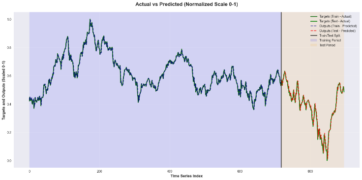
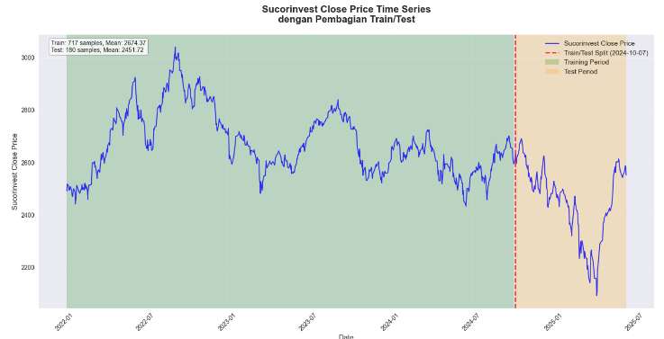
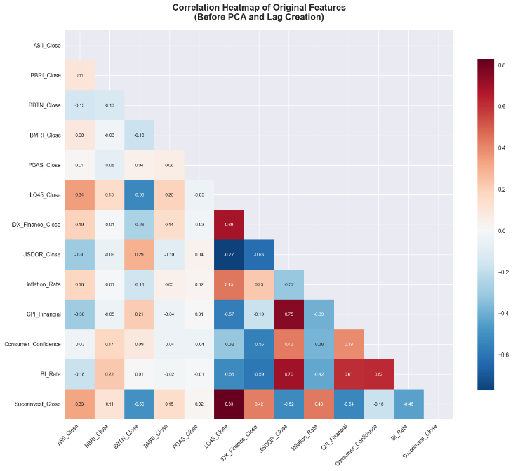
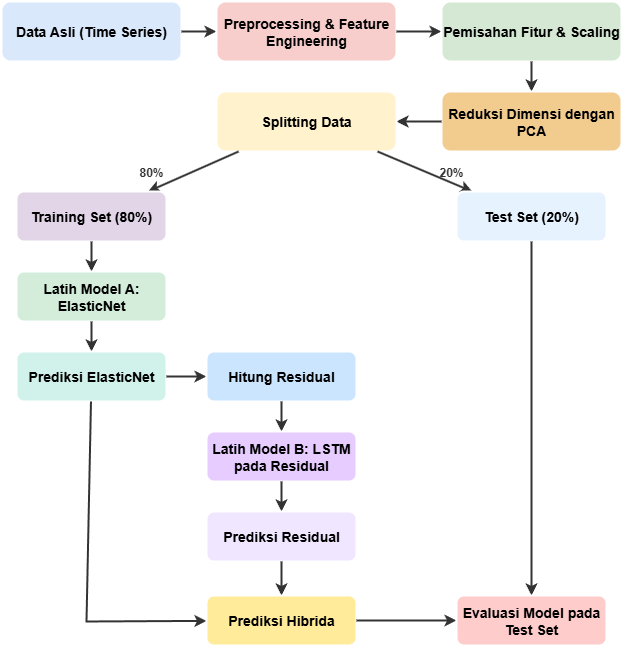
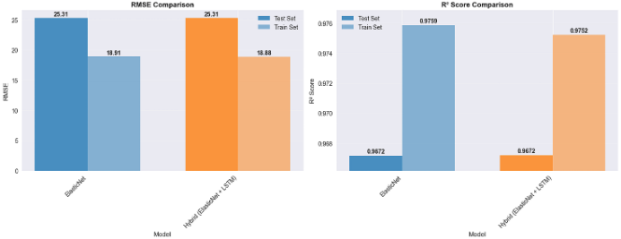
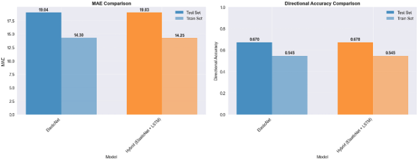

# Forecasting Mutual Fund Prices in Indonesia Using Linear and Hybrid Approaches

## Overview

This research conducts a critical empirical evaluation of financial time-series forecasting: **does incorporating complex deep learning architectures provide statistically significant value over parsimonious linear models for high-persistence asset prices?**

We evaluate a regularized linear regression model (**ElasticNet**) enhanced with autoregressive lag features and **Principal Component Analysis (PCA)** against a two-stage hybrid **ElasticNet-LSTM** architecture that models residual errors. The target asset is the **Sucorinvest Equity Fund**, one of Indonesia's largest and most actively traded equity mutual funds, analyzed across **897 trading days** in the post-pandemic market regime (2022–2025).

---

## Authors & Affiliation

* **Gymnastiar Al Khoarizmy** (First Author)
* **Feryadi Yulius**
* **Elok Fiola**

*Program Studi Sains Data, Fakultas Sains, Institut Teknologi Sumatera (ITERA), Lampung Selatan, Indonesia*

---

## Key Findings & Metrics

* **Baseline ElasticNet:** **$R^2$ = 0.9672**, RMSE = **25.3143** (Normalized RMSE: 0.0267), MAE = **19.0425**, Directional Accuracy = **67.04%**.
* **Hybrid ElasticNet-LSTM:** **$R^2$ = 0.9672**, RMSE = **25.3052** (Normalized RMSE: 0.0267), MAE = **19.0318**, Directional Accuracy = **67.04%**.
* **Diebold-Mariano Hypothesis Test:** **DM = 1.1125, $p$-value = 0.2659**. The performance difference is **not statistically significant** ($p > 0.05$).
* **Empirical Validation of Occam's Razor:** Residual errors after modeling linear price inertia closely resemble **stochastic white noise** (martingale difference sequence). For daily nominal price forecasting, an interpretable and computationally light linear model offers superior practical efficiency over complex neural networks.

---

## Problem & Research Question

In financial machine learning, research often defaults to complex deep recurrent architectures (LSTM, GRU, Transformers) under the unverified assumption of superiority. However, daily financial price levels exhibit extreme **autocorrelation and price inertia** ($lag_1$ dependence). 

This study tests a fundamental hypothesis:
> *Does deep learning non-linear modeling on residuals extract meaningful signal, or does it merely fit stochastic market noise when autoregressive components are already optimally captured?*

---

## Dataset & Feature Engineering

* **Target Variable:** Daily closing Net Asset Value (NAV) of **Sucorinvest Equity Fund** (`Sucorinvest_Close`), spanning **January 6, 2022 to June 13, 2025** (**897 trading days**).
* **Chronological Split:** 
  - **Training Set (80%):** 717 trading days (Jan 6, 2022 – Sep 19, 2024).
  - **Testing Set (20%):** 180 trading days (Sep 20, 2024 – Jun 13, 2025).
* **Internal Features (Temporal Inertia):** $lag_1$, $lag_2$, and $lag_3$ of mutual fund closing prices to capture short-term momentum.
* **12 External Macroeconomic & Market Features:**
  - Constituent stocks: `ASII`, `BBRI`, `BBTN`, `BMRI`, `PGAS` closing prices.
  - Market indices: `LQ45`, `IDX Finance`.
  - Currency exchange: Bank Indonesia `JISDOR` (USD/IDR).
  - Domestic macro indicators: `Inflation Rate`, `BI Rate`, `CPI Financial`, `Consumer Confidence Index`.

### Multicollinearity Treatment with PCA

Due to strong collinearity among financial indicators, Min-Max Scaling and **Principal Component Analysis (PCA)** were applied to the 12 external variables. **9 principal components** were selected, retaining **97.66% cumulative explained variance** while ensuring zero linear correlation among predictors.

---

## Methodology & Workflow

1. **Model A (Baseline ElasticNet):**
   - Combines $L_1$ (Lasso) for feature sparsity and $L_2$ (Ridge) for coefficient stability under collinearity.
   - Tuned via 5-fold time-series cross-validation (`ElasticNetCV`), yielding optimal parameters $\alpha = 0.1842$ and $l_1\text{-ratio} = 0.10$.
   - Feature weights revealed $lag_1$ coefficient of **0.9464**, demonstrating total dominance of price inertia.

2. **Model B (Hybrid ElasticNet + Residual LSTM):**
   - Residual calculated as $e_t = y_t - \hat{y}_{\text{ElasticNet}}$.
   - Deep LSTM network trained to detect latent non-linear temporal dependencies within residuals using the 9 orthogonal PCA features across a **15-day lookback window**.
   - Architecture: 2-layer LSTM (50 and 25 units) with Dropout (0.2) and Dense output layer, optimized using Adam and MSE loss.
   - Final forecast: $\hat{y}_{\text{final}} = \hat{y}_{\text{ElasticNet}} + \hat{e}_{\text{LSTM}}$.

---

## Quantitative Evaluation

| Metric | ElasticNet (Baseline) | Hybrid (ElasticNet + LSTM) | Difference |
|---|---|---|---|
| **RMSE (Rupiah)** | 25.3143 | 25.3052 | -0.0091 (-0.036%) |
| **RMSE (Normalized)** | 0.0267 | 0.0267 | 0.0000 |
| **MAE (Rupiah)** | 19.0425 | 19.0318 | -0.0107 (-0.056%) |
| **MAE (Normalized)** | 0.0201 | 0.0201 | 0.0000 |
| **$R^2$ Score** | **0.9672** | **0.9672** | Identical |
| **Directional Accuracy** | **67.04%** | **67.04%** | Identical |

  
  

### Diebold-Mariano Statistical Hypothesis Test

To verify if the marginal 0.0091 reduction in RMSE was statistically meaningful:
* **Hypothesis:** $H_0: \text{Both models have equal predictive accuracy}$ vs $H_1: \text{Model accuracies differ}$.
* **DM Statistic:** **1.1125**
* **$p$-value:** **0.2659**

With $p \gg 0.05$, we fail to reject $H_0$. The hybrid deep learning model's improvement is **statistically indistinguishable from random chance**.

---

## Why Non-Linear Residual Modeling Failed to Beat Linear Regression

1. **Martingale Property & Efficient Market Dynamics:** Once the dominant linear trend and $lag_1$ autocorrelation are extracted, the remaining residuals approximate a stochastic white noise sequence without exploitable temporal dependencies.
2. **Frequency & Signal-to-Noise Mismatch:** Macroeconomic indicators (inflation, BI rate, consumer confidence) update monthly, remaining flat for weeks in daily data. When mapped through PCA into daily LSTM steps, the signal-to-noise ratio drops drastically, risking noise-fitting.
3. **Price Level vs. Volatility Clustering:** Deep recurrent networks excel at modeling volatility clustering (conditional heteroskedasticity on squared returns), not daily nominal price levels driven by autoregressive momentum.
4. **Occam's Razor:** The simpler model with fewer assumptions and minimal compute requirements should always be preferred when predictive power is equal.

---

## Practical Implications for Asset Management

* **Zero Latency Inference:** ElasticNet executes in microseconds with negligible RAM and CPU footprint, ideal for real-time portfolio rebalancing systems.
* **Explainability & Governance:** Linear coefficients provide transparent risk attribution for fund managers and regulatory auditing (OJK), avoiding black-box neural network risks.

---

## Tech Stack & Tools

* **Languages & Core:** Python
* **Linear & Statistical Modeling:** Scikit-Learn (`ElasticNetCV`, `PCA`, `MinMaxScaler`), SciPy, Statsmodels
* **Deep Learning:** TensorFlow / Keras (LSTM, Dropout, Adam)
* **Statistical Hypothesis Testing:** Diebold-Mariano Test implementation
* **Data Wrangling & Visualization:** Pandas, NumPy, Matplotlib, Seaborn
